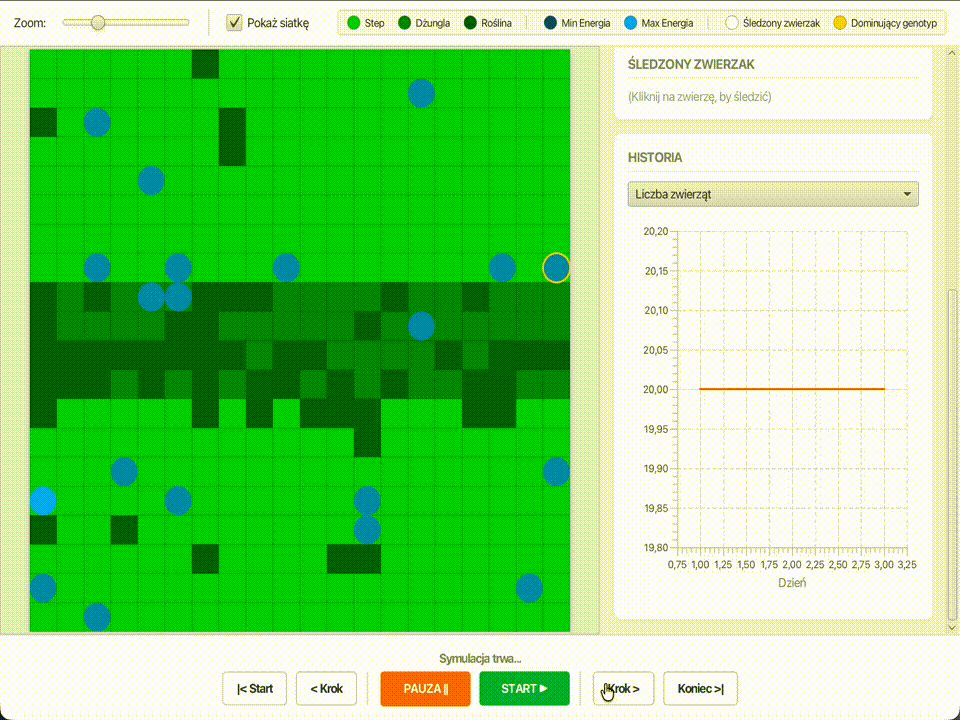

# Darwin World

## Autorzy

1. [**Paweł Bolek**](https://github.com/bol0o)
2. [**Michał Dudek**](https://github.com/MichalDudekk)

## Opis

Darwin World jest symulacja która obrazuje proces ewolucji w wirtualnym świecie. 
Projekt pozwala użytkownikowi na obserwację, jak populacja wirtualnych zwierząt adaptuje się do panujących warunków,
walczy o zasoby i przekazuje materiał genetyczny kolejnym pokoleniom. 

Aplikacja symuluje cykl życia, w którym zwierzęta przemieszczają się po dwuwymiarowej mapie, 
konsumują roślinność w celu pozyskania energii niezbędnej do przeżycia oraz rozmnażają się, 
podlegając presji doboru naturalnego.

### Zaimplementowany wariant

Przydzielony został nam **wariant J** czyli [**FOMO**](https://pl.wikipedia.org/wiki/FOMO).
Więcej o tym jak wariant wpływa na zachowanie zwierząt mona przeczytać [**tutaj**](https://github.com/Soamid/obiektowe-lab/tree/master/proj).

## Informacje o projekcie

Projekt został zrealizowany jako zadanie końcowe w ramach przedmiotu **Programowanie Obiektowe** na kierunku Informatyka
(Wydział Informatyki, Akademia Górniczo-Hutnicza w Krakowie). 

## Kluczowe elementy projektu

- **Świat gry**: Plansza podzielona na komórki, na której współistnieją zwierzęta i rośliny. Mapa posiada strefe gdzie prawdopodobieństwo wzrostu roślin jest wyższe.
- **Genotyp i zachowanie**: Każde zwierzę posiada unikalny kod genetyczny (sekwencję genów), który determinuje sposób jego poruszania się. Genotyp podlega mutacjom podczas reprodukcji, co wprowadza element losowości i ewolucji.
- **Gospodarka energetyczna**: Energia jest walutą życia w symulacji. Jest tracona z reprodukcją oraz każdym ruchem i zyskiwana poprzez zjedzenie rośliny. Spadek energii do zera oznacza śmierć osobnika.
- **Selekcja i reprodukcja**: Do rozmnażania przystępują tylko osobniki o wystarczającym poziomie energii. Potomstwo dziedziczy geny od obojga rodziców proporcjonalnie do ich energii.

## Funkcjonalność

- **Konfigurowalność**: Możliwość definiowania parametrów początkowych symulacji (rozmiar mapy, ilość startowa zwierząt, koszt ruchu, energia roślin itp.) poprzez plik konfiguracyjny lub formularz startowy.
- **Wielowątkowość**: Możliwość uruchomienia wielu niezależnych symulacji jednocześnie w oddzielnych oknach.
- **Śledzenie statystyk**:
  - Bieżąca liczba zwierząt, roślin, 
  - średni poziom energii, 
  - średnia długość życia.
  - Wyróżnianie zwierząt o dominującym genotypie.
- **Obserwacja osobnika**: Możliwość kliknięcia w konkretne zwierzę i śledzenia jego losów (ilość potomsta, wiek, moment śmierci itp.).
- **Eksport danych**: Zapisywanie statystyk przebiegu symulacji do pliku CSV w celu dalszej analizy.

## Implementacja i Technologie

## Architektura i wzorce

## Techstack